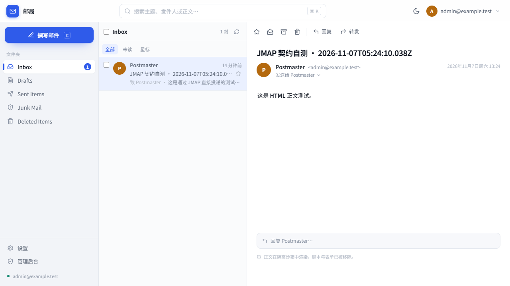
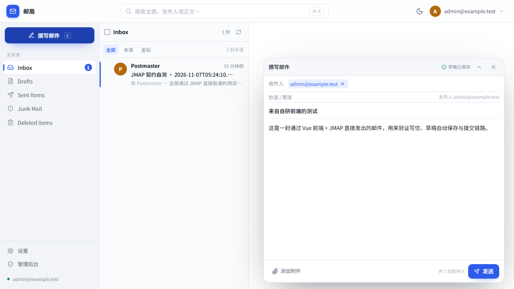
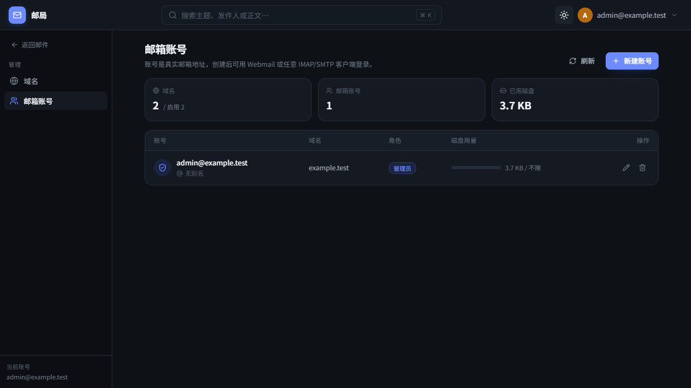

# 自建邮局（Stalwart + 自研 Vue 前端）

个人自托管邮件系统：后端是现成的 Stalwart（单容器，内置 SMTP/IMAP/JMAP/CalDAV），
前端是自研 Vue SPA，构建成静态文件后由**宿主机 Nginx** 托管，**不进容器**。

```
浏览器 ──HTTPS 443──> Nginx ──静态 dist──> 浏览器
                        └──/jmap──> Stalwart 容器 127.0.0.1:443 ──> RocksDB 卷
邮件客户端 ──25/465/587/993/995──> Stalwart 容器
Stalwart 容器 ──465──> 第三方 SMTP 中继（出站 25 被封时，见 docs 第 4 节）
```



| 写信抽屉 | 管理后台（深色） |
|---|---|
|  |  |

## 前置条件

- 一台公网 Linux 服务器（本方案按 2G 内存调优，容器限额 1G）
- 一个可管理 DNS 的域名，例如 `example.com`，并准备 `mail.example.com` 的 A 记录
- 已安装 Docker + Docker Compose v2、Nginx、certbot
- 端口 25 / 465 / 587 / 993 / 995 / 4190 / 443 至少内网可达；出站 25 若被云厂商封禁（腾讯云/阿里云常见），
  按 `docs/dns-and-deliverability.md` 第 4 节改走第三方中继（465）发信，收信仍在本机

## 5 分钟上手

```bash
# 1) 配置
cp .env.example .env
vim .env            # 改 MAIL_HOST / MAIL_DOMAIN / ADMIN_MAIL

# 2) 拉起后端
make up
docker compose ps   # 等 healthy

# 3) 初始化（只在第一次需要）
make setup          # 打印取密码与建隧道的命令
```

向导要点：

1. Server hostname 填 `mail.example.com`，默认邮件域填 `example.com`
2. 目录类型保持「内置目录」，向导最后一屏会显示 `admin@example.com` 与随机密码，**只显示一次**
3. 第 4 屏日志目标必须选 **Console**（容器内没有 `/var/log/stalwart`）
4. 向导写盘后必须 `make restart`，否则服务仍停在 bootstrap 模式

```bash
# 4) 前端
make frontend-install
make frontend-dev      # 本地开发，Vite 已把 /jmap 代理到后端
make frontend-build    # 产出 frontend/dist

# 5) 部署前端（宿主机 Nginx，不进容器）
sudo cp deploy/nginx/stalwart-proxy.conf /etc/nginx/snippets/
sudo cp deploy/nginx/mail.example.com.conf /etc/nginx/sites-available/
sudo ln -s /etc/nginx/sites-available/mail.example.com.conf /etc/nginx/sites-enabled/
make frontend-deploy   # 构建 + 原子软链发布 + reload nginx
```

## 常用命令

| 命令 | 作用 |
|---|---|
| `make up` / `make down` | 启停后端 |
| `make logs` | 跟踪后端日志 |
| `make setup` | 打印初始化步骤与取密码命令 |
| `make backup` | 冷备（会短暂停容器，RocksDB 必须冷备） |
| `make restore ARCHIVE=...` | 从备份恢复 |
| `make probe` | 跑 JMAP 探针，校验后端接口契约 |
| `make frontend-dev` | 前端本地开发 |
| `make frontend-deploy` | 构建并发布前端 |
| `make certs` | 证书续期后重载 Nginx 与后端 |

## 目录

```
docker-compose.yml        后端唯一服务（+ 注释掉的 postgres profile）
deploy/nginx/             站点配置与反代片段
deploy/scripts/           backup / restore / deploy-frontend
tools/jmap-probe/         JMAP 契约探针（独立于前端工程）
docs/                     接口契约、部署、DNS、内存调优
frontend/                 Vue 3 + Vite + TS + Tailwind v4
data/                     运行时数据（不入库，需自行备份）
```

## 已验证到什么程度

以下均在本地真实 Stalwart 实例 + 真实浏览器里跑通过（不是「照文档写的」）：

- 登录（Basic 认证 + session 发现 + 账号能力识别）
- 收件箱列表、未读计数、打开阅读、自动标记已读
- HTML/纯文本正文在 sandbox iframe 中渲染，外部图片默认拦截并可放行
- 写信 → 草稿自动保存 → 发送 → 归档到已发送 → 收件箱收到（同域投递全链路）
- 管理后台：域名列表（含服务端生成的 DNS zone）、新建域名、新建邮箱账号（含配额与别名）、改密码、删除账号
- 浅色/深色主题、移动端单栏布局
- 前端 25 个单元测试

已知限制：

- 草稿箱里的草稿暂不支持「点开继续编辑」（协议层要重建 Email，见 `docs/jmap-contract.md` 6.1.1）
- 发信身份只支持每个账号的第一个 identity
- 管理 API 需要管理员权限，普通账号进设置页只能改外观与隐私偏好

## 明确的取舍

- **没有 BFF**：浏览器直连 JMAP，前端不写任何服务端代码。代价是必须吃 JMAP 协议（批量 methodCalls），换来的是零后端运维。
- **用内嵌 RocksDB**：2G 内存下再跑一个 PostgreSQL 不划算。将来要集群必须改成共享存储，见 `docker-compose.yml` 注释。
- **关闭反垃圾与全文索引**：内存硬约束下的裁剪，垃圾邮件靠 JMAP Sieve 规则与客户端判断，见 `docs/memory-tuning.md`。
- **前端不进容器**：`dist` 由宿主机 Nginx 直接返回，发布用软链原子切换，回滚只需把 `current` 指回上一版。

## 文档

- `docs/jmap-contract.md` —— 实测的 JMAP 与管理 API 契约
- `docs/deployment.md` —— 反代、证书、端口、升级、回滚
- `docs/dns-and-deliverability.md` —— MX/SPF/DKIM/DMARC/PTR，以及出站 25 被封时改走腾讯云 SES 中继（465）的完整步骤
- `docs/memory-tuning.md` —— 2G 下的裁剪项与观测方法
